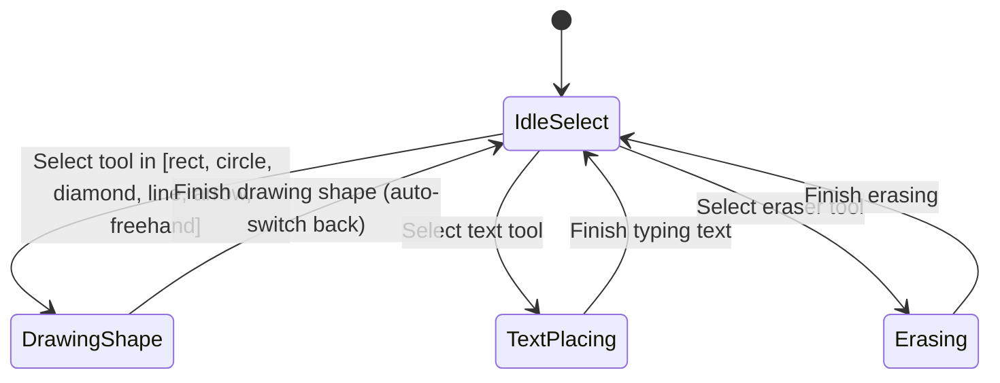

# Interaction Inventory: State Machines & User Workflows

This document specifies the exact behavioral state machines, coordinate mathematics, and event handling logic required to reproduce Excalidraw's core whiteboard interactions.

---

## 1. Coordinate Transformation Logic

The whiteboard operates in two distinct coordinate systems:
1. **Screen / Viewport Coordinates $(x_s, y_s)$:** Mouse event positions relative to the canvas DOM element.
2. **Scene / World Coordinates $(x_w, y_w)$:** True absolute coordinates of objects on the infinite canvas.

### Formulas:
$$\begin{aligned}
x_w &= \frac{x_s - \text{pan.x}}{\text{zoom}} \\
y_w &= \frac{y_s - \text{pan.y}}{\text{zoom}}
\end{aligned}$$

$$\begin{aligned}
x_s &= x_w \cdot \text{zoom} + \text{pan.x} \\
y_s &= y_w \cdot \text{zoom} + \text{pan.y}
\end{aligned}$$

---

## 2. Interaction State Machines

### 2.1 Tool Selection & Mode Switching


---

### 2.2 Shape Creation Interaction (Rectangle, Circle, Diamond, Line, Arrow)
- **Trigger:** Active tool is a geometric shape.
- **Phase 1: `pointerdown`:**
  1. Record starting point $P_{\text{start}} = (x_w, y_w)$.
  2. Instantiate new draft element:
     ```javascript
     {
       id: generateId(),
       type: activeTool, // 'rectangle' | 'circle' | 'diamond' | 'line' | 'arrow'
       x: x_w,
       y: y_w,
       width: 0,
       height: 0,
       strokeColor: styles.strokeColor,
       backgroundColor: styles.backgroundColor,
       strokeWidth: styles.strokeWidth,
       strokeStyle: styles.strokeStyle,
       opacity: styles.opacity
     }
     ```
  3. Enter `DRAWING` interaction state.
- **Phase 2: `pointermove`:**
  1. Update draft element dimensions:
     - For rectangles, circles, diamonds:
       $$x = \min(P_{\text{start}}.x, x_w)$$
       $$y = \min(P_{\text{start}}.y, y_w)$$
       $$\text{width} = |x_w - P_{\text{start}}.x|$$
       $$\text{height} = |y_w - P_{\text{start}}.y|$$
     - For lines and arrows:
       $$x = P_{\text{start}}.x, \quad y = P_{\text{start}}.y$$
       $$\text{width} = x_w - P_{\text{start}}.x, \quad \text{height} = y_w - P_{\text{start}}.y$$
  2. Repaint canvas immediately for real-time visual feedback.
- **Phase 3: `pointerup`:**
  1. If element width > 2 or height > 2:
     - Append to `elements` state array.
     - Push previous state to `undoStack` and clear `redoStack`.
     - Automatically reset active tool to `'select'` (unless lock mode is active).
     - Set new element as active selection.
  2. Exit `DRAWING` state.

---

### 2.3 Freehand Drawing Interaction (Pencil / Sketch)
- **Phase 1: `pointerdown`:**
  1. Record initial point: `points = [[x_w, y_w]]`.
  2. Initialize freehand element with `points` array and bounding box `x = x_w, y = y_w`.
- **Phase 2: `pointermove`:**
  1. Append $(x_w, y_w)$ to `points`.
  2. Update bounding box `(minX, minY, maxX - minX, maxY - minY)`.
  3. Repaint smooth quadratic or polyline curve through recorded points.
- **Phase 3: `pointerup`:**
  1. Commit freehand path to `elements` list.
  2. Push to `undoStack`.

---

### 2.4 Text Creation & Inline Editing
- **Phase 1: Creation:**
  1. Active tool is `'text'`. User clicks on canvas at $(x_w, y_w)$.
  2. Mount `<InlineTextEditor>` at exact screen position $(x_s, y_s)$.
  3. Focus textarea with placeholder text or empty string.
- **Phase 2: Live Editing:**
  1. User types content. Textarea width/height auto-expands.
- **Phase 3: Commit:**
  1. User presses `Escape` or clicks outside (triggers `blur`).
  2. If trimmed text is non-empty:
     - Compute text bounding width and height based on font metrics.
     - Create text element: `{ type: 'text', text: value, x: x_w, y: y_w, ... }`.
     - Append to elements, record in history.
  3. Unmount textarea DOM node.

---

### 2.5 Selection & Object Manipulation
- **Click Selection:**
  1. Perform point hit testing in reverse order (top-most element first).
  2. If hit: set `selectedId = element.id`.
  3. If no hit: deselect (`selectedId = null`), initialize selection marquee box.
- **Marquee Selection:**
  1. Dragging on empty space draws dashed selection box.
  2. On release, all elements intersecting or contained within the bounding box are selected.
- **Moving Elements:**
  1. Pointer down on selected element records offset:
     $$\Delta x = x_w - \text{element.x}, \quad \Delta y = y_w - \text{element.y}$$
  2. Pointer move translates element coordinates:
     $$\text{element.x} = x_w - \Delta x, \quad \text{element.y} = y_w - \Delta y$$
  3. Pointer up finalizes positions and records history snapshot.

---

### 2.6 Zoom & Pan Interactions
- **Pan Interaction:**
  - Hold `Space` key or Middle Mouse Click + drag:
    $$\text{pan.x} \mathrel{+}= \Delta x_s, \quad \text{pan.y} \mathrel{+}= \Delta y_s$$
  - Hand cursor (`grab` / `grabbing`).
- **Zoom Interaction:**
  - Zoom In / Zoom Out buttons adjust zoom by $\pm 10\%$, bounded between $10\%$ and $300\%$.
  - Wheel Zoom (`Ctrl` + Wheel): Centered at mouse location $(x_s, y_s)$.

---

### 2.7 Undo & Redo History System
- **State Structure:**
  - `history`: array of snapshots `elements[]`.
  - `historyIndex`: integer pointer to active state.
- **Action Triggers:**
  - When user finishes an action (drawing shape, dragging, editing text, styling, deleting):
    - Truncate all history forward of `historyIndex`.
    - Push new snapshot.
    - Increment `historyIndex`.
  - On Undo (`Ctrl+Z`): decrement `historyIndex`, restore snapshot.
  - On Redo (`Ctrl+Y` or `Ctrl+Shift+Z`): increment `historyIndex`, restore snapshot.

---

### 2.8 Keyboard Shortcuts Matrix

| Key / Shortcut | Action | Scope |
| :--- | :--- | :--- |
| `1` or `V` | Switch to Selection Tool | Global |
| `2` or `R` | Switch to Rectangle Tool | Global |
| `3` or `D` | Switch to Diamond Tool | Global |
| `4` or `O` / `C` | Switch to Circle/Ellipse Tool | Global |
| `5` or `A` | Switch to Arrow Tool | Global |
| `6` or `L` | Switch to Line Tool | Global |
| `7` or `P` | Switch to Freehand Pencil Tool | Global |
| `8` or `T` | Switch to Text Tool | Global |
| `9` or `E` | Switch to Eraser Tool | Global |
| `Delete` / `Backspace` | Delete selected element(s) | When element selected |
| `Ctrl+Z` / `Cmd+Z` | Undo | Global |
| `Ctrl+Y` / `Ctrl+Shift+Z` | Redo | Global |
| `Ctrl+A` | Select All elements | Global |
| `Space` + Drag | Canvas Pan | Global |
| `+` / `=` | Zoom In | Global |
| `-` | Zoom Out | Global |
| `0` | Reset Zoom to 100% | Global |
| `Escape` | Deselect element / Cancel active tool | Global |

